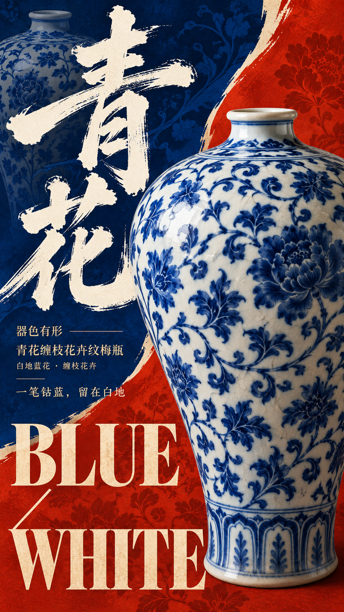
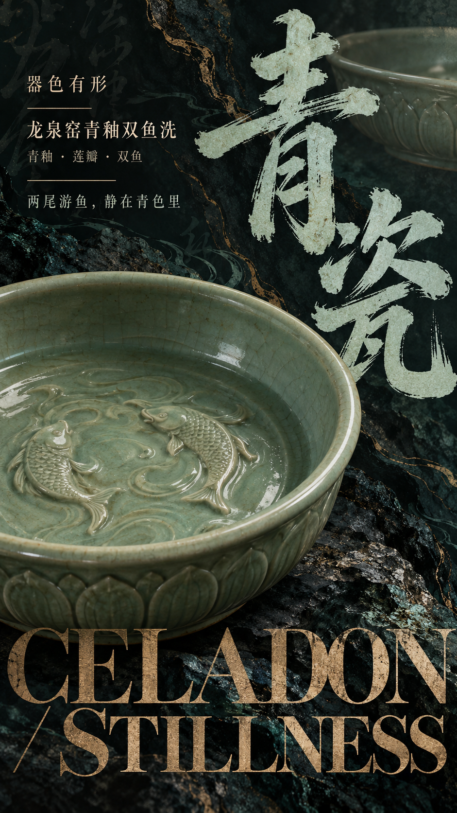
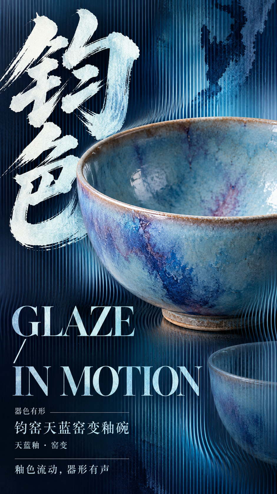
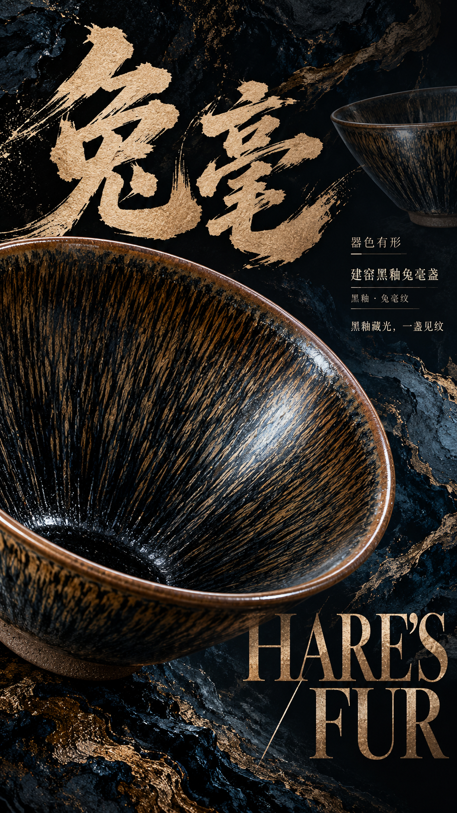
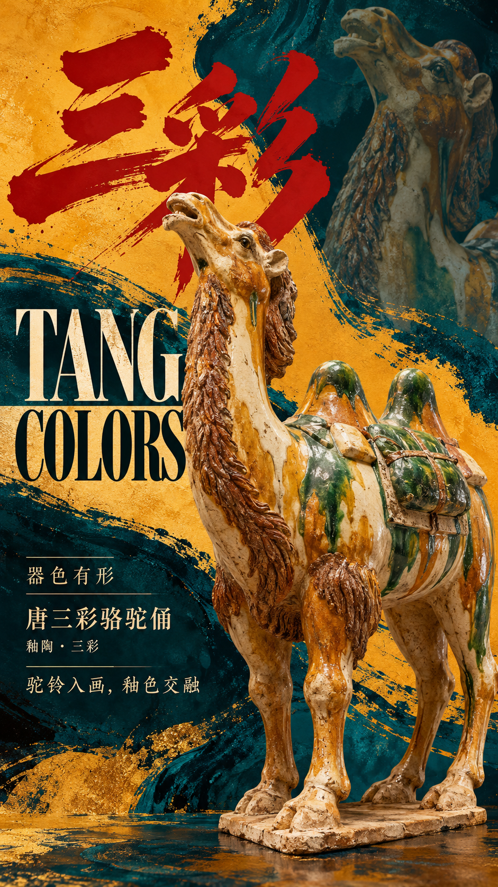
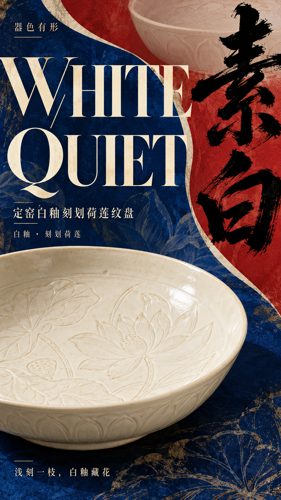
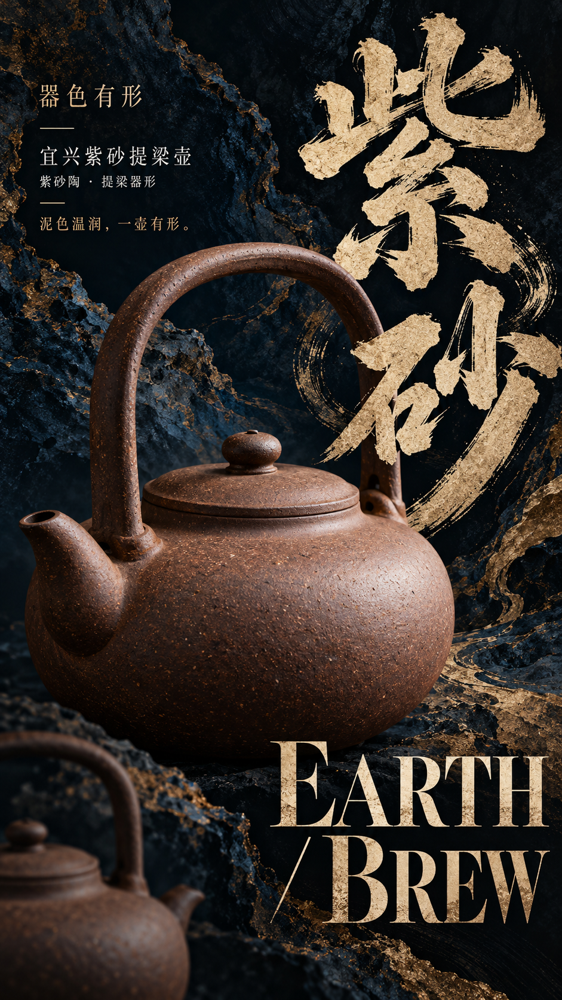
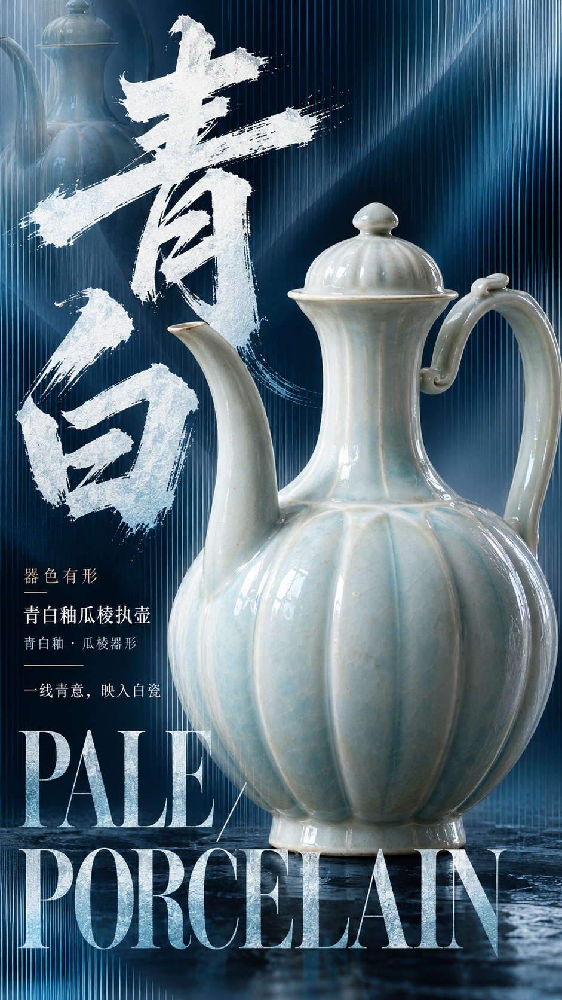

# 器色有形·东方文博实验字体海报 Skill / Colors of Heritage Poster Skill

## 作品展示 · Gallery

以下海报均由本 Skill 生成。

| | | |
|---|---|---|
|  |  |  |
| 青花 | 青瓷 | 钧色 |
|  |  |  |
| 兔毫 | 三彩 | 素白 |
|  |  | |

以一件真实器物为核心，融合毛笔书法、博物馆展陈视觉、复古编辑设计与现代实验字体，生成一张 9:16 东方文博海报。

## 它能做什么
- 器型准确、藏品摄影级质感的核心器物，可出血出画，并与文字前后遮挡
- 巨型飞白书法 + 大号复古衬线英文标题 + 完整编辑信息层级
- 三种视觉模式：深色矿物 / 高饱和撞色 / 渐变光栅
- 只给文化主题也能用：自动选择真实器物、标题与模式

## 安装
**作为 Agent Skill（Claude Code / Cursor / Codex 等）**：

```bash
git clone https://github.com/ericchan916/colors-of-heritage-poster-skill.git
cp -r colors-of-heritage-poster-skill ~/.claude/skills/colors-of-heritage-poster
# 或 ~/.cursor/skills/、~/.codex/skills/ 等
```

**在 ChatGPT / 其他图像模型中使用**：复制 [`prompt.md`](prompt.md) 里的完整提示词，填入字段即可。

## 使用示例
```
【文化主题】：建盏
【视觉模式】：深色矿物
```
或只写：`【文化主题】：青花瓷`

更多示例见 [`examples/themes.md`](examples/themes.md)。

## 视觉模式
| 模式 | 色彩 | 特征 |
|---|---|---|
| 深色矿物 | 墨黑、深蓝、青铜金 | 矿物质感、局部金属、半透明书法底纹 |
| 高饱和撞色 | 两种鲜明主色 | 大面积分区、有机曲线、器物出画、超大字体 |
| 渐变光栅 | 青蓝 / 靛紫渐变 | 竖向光栅线在器物边缘弯折，欧普艺术效果 |

## English
**Colors of Heritage Poster** creates one 9:16 Eastern museum-grade poster around a real, accurately rendered artifact, with giant brush calligraphy, a retro serif English title and three visual modes (Dark Mineral, High-saturation Clash, Gradient Lenticular). Copy the folder into your agent's skills directory, or paste `prompt.md` into ChatGPT or any image model.

## License
MIT © 2026 Joy Robinson — 见 [LICENSE](LICENSE)。生成图片的使用请同时遵守你所用图像模型的服务条款。
